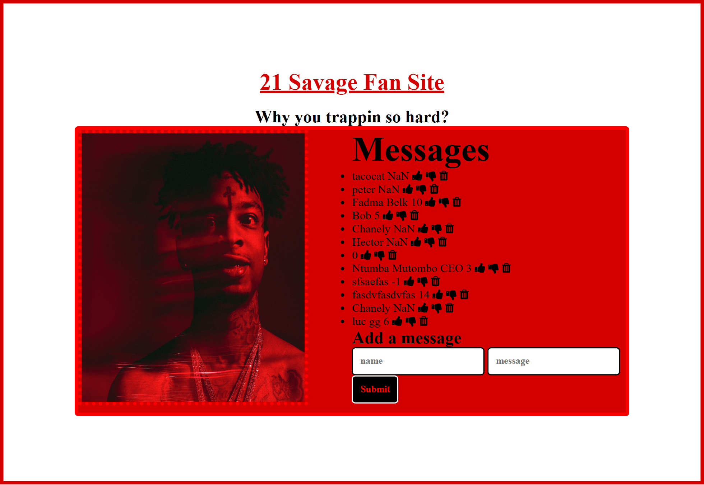

# Savage Demo Fan Site

## Project Description

Savage Demo is a rework of a previous 21 Savage Fan Site. This is a fullstack social media app where users can post, delete, and vote on a messaging board. This project began as a debugging exercise on a codebase that was created in 2017. I was able to fix the thumbs down button and the delete method trash can. 

### How It's Made:

* HTML & CSS – Structure and styling
* JavaScript – Front-end and back-end functionality
* Node.js – Server-side JavaScript
* Express.js – Routes and handling requests
* MongoDB – Storing messages
* EJS – Displaying dynamic content

## Installation

1. Clone repo
2. run `npm install`

---

# Things to add

- Create a `.env` file in config folder and add the following as `key = value`
  - PORT = 3000
  - DB_STRING = `your database URI`
 
---

## Usage

1. run `npm run savage`
2. Navigate to `localhost:3000

## Screenshots and Demo

### Application Interface

